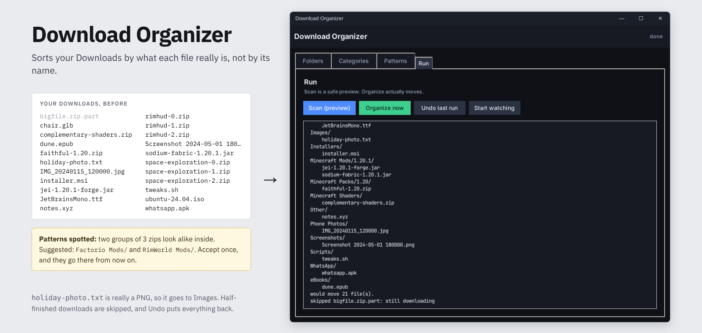
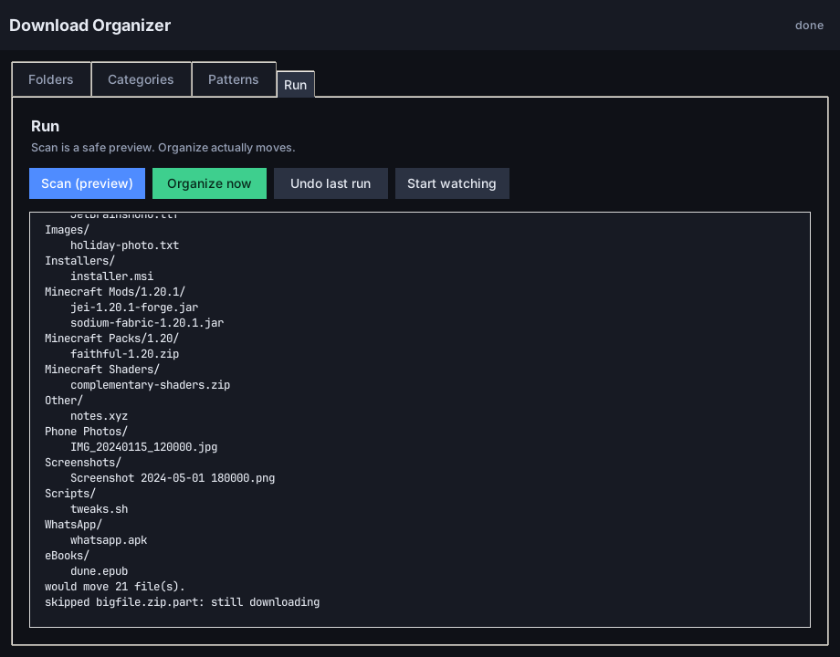
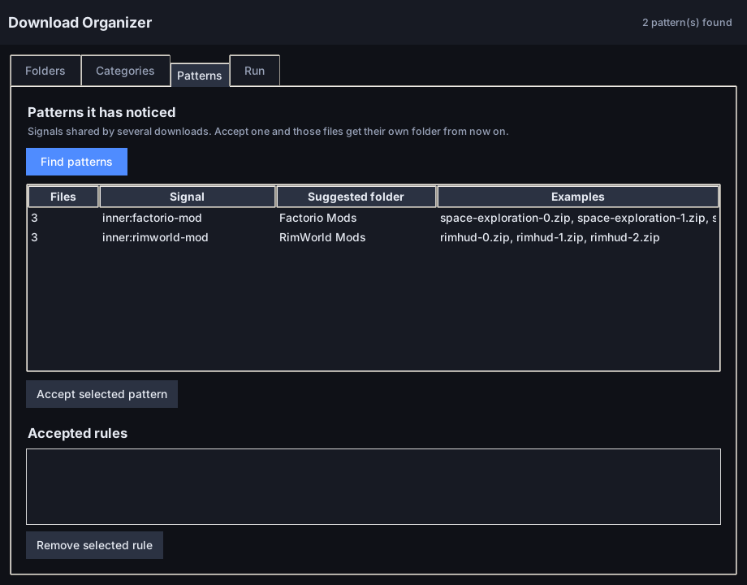

<div align="center">



<br />

**[Download the app (.exe)](https://github.com/M7neeb/download-organizer/raw/main/dist/DownloadOrganizer.exe)** &nbsp;·&nbsp; [Features](#features) &nbsp;·&nbsp; [How it decides](#how-it-decides-where-a-file-goes) &nbsp;·&nbsp; [Command line](#command-line) &nbsp;·&nbsp; [Build it yourself](#learn-by-building-it)

<br />


[](LICENSE)

</div>

<br />

Download Organizer sorts your Downloads folder into tidy category folders. It does not just trust
the file name: it opens each file and looks at what is really inside. A PNG saved as `.txt` still
lands in **Images**, and a `.zip` that is really a Minecraft mod goes to **Minecraft Mods**.

Its best trick is the **pattern engine**. When several downloads share an unusual trait (all Factorio
mods, all screenshots, all Android apps), it notices and suggests a folder for them. Accept the
suggestion once and it files them there from then on. Nothing about any game is hard-coded: it learns
from what is in *your* downloads.

## Features

<table>
  <tr>
    <td width="50%" valign="top">
      <h3>Smart sorting</h3>
      <ul>
        <li><b>Real file types</b> read from the first bytes: images, video, audio, fonts, 3D models, documents, installers, archives.</li>
        <li><b>Looks inside archives</b> for tell-tale files: Minecraft mods, packs and shaders, Android apps, Office files, EPUBs, Factorio and RimWorld mods, Node and Docker projects.</li>
        <li><b>Recognises names</b> like screenshots, WhatsApp files, invoices, receipts and phone or camera photos.</li>
        <li><b>Version subfolders</b>, for example <code>Minecraft Mods/1.20.1/</code>.</li>
      </ul>
    </td>
    <td width="50%" valign="top">
      <h3>Safe by design</h3>
      <ul>
        <li><b>Scan first:</b> a preview that moves nothing.</li>
        <li><b>Undo</b> puts back the last run. The last 20 runs are kept.</li>
        <li><b>Leaves half-finished downloads alone</b> (<code>.part</code>, <code>.crdownload</code>, <code>.tmp</code> and files changed seconds ago).</li>
        <li><b>Never overwrites:</b> duplicates become <code>name (1).ext</code>.</li>
        <li><b>Fully local.</b> Nothing is uploaded anywhere.</li>
      </ul>
    </td>
  </tr>
  <tr>
    <td width="50%" valign="top">
      <h3>Learns your patterns</h3>
      <ul>
        <li>Spots traits that several downloads share and suggests a folder for them.</li>
        <li>Accept a suggestion once and it becomes a rule that always wins.</li>
        <li>Adding a new kind of file is mostly data: one line in <code>patterns.py</code>.</li>
      </ul>
    </td>
    <td width="50%" valign="top">
      <h3>Your way</h3>
      <ul>
        <li><b>Watch mode</b> keeps the folder tidy while you download.</li>
        <li><b>Edit the categories</b> and their extensions in the app.</li>
        <li><b>One file:</b> the .exe runs from anywhere and keeps its settings in <code>%APPDATA%\DownloadOrganizer</code>.</li>
      </ul>
    </td>
  </tr>
</table>

## A closer look

<table>
  <tr>
    <td width="50%"></td>
    <td width="50%"></td>
  </tr>
  <tr>
    <td align="center"><b>Scan</b> shows where every file would go before anything moves.</td>
    <td align="center"><b>Patterns</b> it noticed, each with a suggested folder.</td>
  </tr>
</table>

## Getting started

**The easy way:** [download `DownloadOrganizer.exe`](https://github.com/M7neeb/download-organizer/raw/main/dist/DownloadOrganizer.exe)
and double-click it. Windows may show a SmartScreen warning because the app is not signed: click
**More info**, then **Run anyway**.

**From source** (Python 3.8 or newer, nothing to install):

```bash
git clone https://github.com/M7neeb/download-organizer.git
cd download-organizer
python gui.py
```

The window has four tabs:

| Tab | What it does |
| --- | --- |
| **Folders** | Which folder to watch and where to put the sorted folders. |
| **Categories** | The folders and the extensions that belong in each. |
| **Patterns** | Find patterns and accept them as rules. |
| **Run** | Scan (preview), Organize, Undo and Start watching. |

## How it decides where a file goes

Checked in this order, the first match wins:

1. **Rules you accepted** in the Patterns tab.
2. **Automatic signals:** things that clearly belong in their own folder (screenshots by name,
   Android apps by their contents, Minecraft mods and so on).
3. **The real file type**, read from the file's first bytes.
4. **The extension**, using the lists in the Categories tab.

Inside archives it looks for files such as `fabric.mod.json`, `pack.mcmeta`, `AndroidManifest.xml`,
`info.json`, `About/About.xml`, `package.json` and `Dockerfile`. Each one it recognises is a *signal*.

## Command line

Everything the window does also works from a terminal:

```bash
python organizer.py                  # sort Downloads once
python organizer.py --dry-run        # preview, change nothing
python organizer.py --watch 30       # re-scan every 30 seconds
python organizer.py --suggest        # list the patterns it has noticed
python organizer.py --accept inner:factorio-mod --folder "Factorio Mods"
python organizer.py --undo           # put back the last run
```

### Try it on a fake folder first

```bash
python make_demo_files.py                    # makes demo_downloads/
python organizer.py demo_downloads --dry-run
python organizer.py demo_downloads --suggest
```

`demo_downloads/` is a made-up Downloads folder with small but real files, so you can experiment
without touching your own.

## Build the .exe yourself

```bash
pip install pyinstaller
python -m PyInstaller --onefile --windowed --name DownloadOrganizer run.py
```

The app lands in `dist/DownloadOrganizer.exe`. That single file is the whole app.

## Learn by building it

Two beginner guides walk through the whole project. No Python experience needed.

- **[Build-along guide](guides/BUILD-ALONG.md)**: type the real app yourself, file by file, with a
  checkpoint after every step. Start here.
- **[Tutorial](guides/TUTORIAL.md)**: the ideas behind it (magic bytes, signals, patterns, undo),
  explained by building small throwaway versions.

Both also come as HTML pages ([build-along](guides/BUILD-ALONG.html), [tutorial](guides/TUTORIAL.html))
with a clickable table of contents, for reading offline in a browser.

## Project layout

```
download-organizer/
├── organizer.py        # the engine: classify, move, undo
├── patterns.py         # the pattern engine: signals and suggestions
├── config.py           # settings and where they are stored
├── history.py          # the undo history
├── gui.py              # the desktop window (tkinter)
├── run.py              # entry point for the .exe
├── make_demo_files.py  # builds a safe fake Downloads folder
├── guides/             # the build-along guide and the tutorial
├── docs/               # pictures for this page
└── dist/
    └── DownloadOrganizer.exe
```

## License

[MIT](LICENSE)
